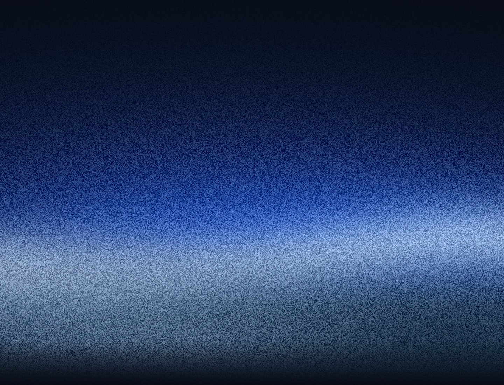

# WiC Weekly: Blue Hour artwork

Decorative artwork for the Blue Hour newsletter. Headings, dates, event details, buttons and links stay as live HTML in the generator.



## Files and display sizes

| File | Native pixels | Intended display size |
| --- | --- | --- |
| `blue-hour.png` | 1440 × 1100 | 720 × 550 CSS pixels |
| `curiosity.png` | 1440 × 400 | 720 × 200 CSS pixels |
| `curiosity-master.png` | 1440 × 640 | Original full-height artwork |
| `footer.png` | 1440 × 500 | 720 × 250 CSS pixels |
| `panel-glass.png` | 540 × 700 | Translucent contents-panel overlay |
| `social-*.svg` | Vector | Editable logo masters |
| `social-*.png` | 192 × 192 | 24 × 24 CSS pixels in email |

The backgrounds retain the approved native grain scale at 2× the intended display size. The header and fact artwork use the original full-colour pixels. The fact-card crop removes 120 pixels from the top and bottom without resizing. The footer and glass overlay are copied unchanged from the approved renderer. All PNGs use lossless compression; there is no JPEG conversion, artificial upscaling or additional palette reduction. The existing footer source is an indexed PNG.

The email icons are rendered directly from the SVG masters at 8× their displayed size. Use the PNG versions inside emails for Outlook compatibility; keep the SVGs for browser previews and future exports.

## Hosted URLs after merge

Base URL:

```text
https://raw.githubusercontent.com/MarilynA23/wic-assets/main/brand/blue-hour/v1/
```

For example:

```html

```

Use raw image URLs, not GitHub `/blob/` page URLs. Keep `v1` unchanged once newsletters use it. Publish later artwork under a new version folder so old emails retain their design. A sender can pin the merge commit SHA in place of `main` when it needs immutable URLs.

`manifest.json` records dimensions, colour modes, byte sizes and SHA-256 hashes for every image. `preview.html` provides a local view at the intended display sizes.

## Sending status

This PR supplies artwork only. It does not send email, publish the generator or configure Power Automate. Attaching an HTML or EML file does not turn it into the message body. Outlook's OFT template import is being evaluated separately for the manual HTML workflow; the complete newsletter still needs an Outlook rendering check with these hosted assets.

## Outlook date and paper backgrounds

Outlook removes the date tile’s CSS gradient overlay. `date-tile.png` (1440 × 210) and `date-tile-mobile.png` (1440 × 198) flatten the approved Blue Hour overlay into full-colour lossless backgrounds at the original 2× grain scale. Display at 720 × 105 and 720 × 99 CSS pixels, centred inside the date tile. The date itself stays live HTML. These reproduce the original `#101a29a3` to `#101a29f0` overlay, 80% opacity and 52% background position.

`paper.png` is a uniform 2 × 2 image in the approved `#0b1019` navy, used as a repeating background to avoid Outlook’s grey recolouring. Flat colour has no resolution limit. These files add backgrounds without changing the previously published assets.
